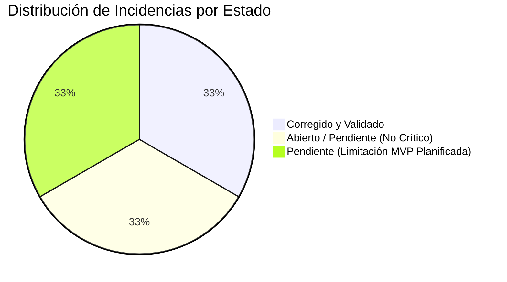

# 🐛 Registro de Incidencias y Limitaciones Técnicas — Sprint 2

**Proyecto:** VitalCampus V 1.0  
**Fecha de corte:** Octubre 2026  
**Responsable de Auditoría:** Equipo de Calidad y Desarrollo VitalCampus  

---

## 📋 Tabla de Incidencias y Hallazgos

| ID | Fecha | Módulo | Descripción de la Incidencia | Severidad | Estado | Solución Aplicada / Plan de Mitigación | Evidencia |
| :--- | :---: | :--- | :--- | :---: | :---: | :--- | :--- |
| **INC-001** | 2026-10-08 | Frontend / Build (Angular CLI) | **Advertencias de presupuesto de tamaño (*Budgets*) durante el build de producción:** El bundle inicial (`623.21 kB`) supera el umbral de advertencia configurado en `angular.json` (`500 kB` por `111.21 kB`), y varios componentes (`resumen`, `asignaturas`, `app`, `sueno`, `estudio`, `entregas`) exceden el límite de estilos de componente (`2 kB` por `0.2 - 1.3 kB`). No interrumpe la compilación ni causa fallas en tiempo de ejecución. | **Baja** *(No Funcional)* | **Abierto / Pendiente** | Se planifica modularizar hojas de estilo comunes en `styles.css` global y ajustar los umbrales de presupuesto en `angular.json` para reflejar el tamaño de librerías como Chart.js. | Salida de `ng build` con advertencias `[WARNING] bundle initial exceeded maximum budget`. |
| **INC-002** | 2026-10-08 | Backend / Autenticación y Seguridad | **Uso de usuario demo temporal en middleware sin autenticación JWT real:** El backend emplea `usuarioDemoMiddleware` asignando de manera transparente el usuario `estudiante@vitalcampus.com` a todas las peticiones entrantes. Esto constituye una limitación de seguridad conocida y documentada para el MVP del Sprint 2, ya que no permite sesiones concurrentes individuales ni aislamiento multiusuario real por token. | **Media** *(Limitación de Arquitectura MVP)* | **Pendiente (Planificado Sprint 3)** | Diseñar e implementar el módulo de autenticación con JSON Web Tokens (JWT), endpoints `/api/auth/login` y `/api/auth/register`, almacenamiento de contraseñas con bcrypt, y extracción dinámica del `usuarioId` del payload del token. | Archivo [`backend/src/middlewares/auth.middleware.ts`](file:///c:/Users/Asus/Desktop/vitalcampus/backend/src/middlewares/auth.middleware.ts#L1-L60) y cabeceras HTTP de peticiones. |
| **INC-003** | 2026-10-08 | Backend / Controlador de Sueño | **Falta de validación explícita del rango permitido (1 a 5) en `calidadSueno` y `nivelEstres`:** En `POST /api/suenos` y `PUT /api/suenos/:id`, se permitía el envío de valores enteros fuera del rango [1, 5] (ej. valores como 9 o -1), almacenándose en SQLite sin validar la regla de dominio. | **Media** *(Integridad de Datos)* | **Corregido y Validado** | Se añadieron validaciones estrictas en `sleep.controller.ts` para comprobar que `calidadSueno` y `nivelEstres` sean enteros numéricos dentro del rango 1 a 5, retornando HTTP 400 Bad Request con mensaje descriptivo si el valor es inválido. | Bloque de código en [`backend/src/controllers/sleep.controller.ts`](file:///c:/Users/Asus/Desktop/vitalcampus/backend/src/controllers/sleep.controller.ts#L65-L86) y prueba automatizada `TC-004` en `test-suite.js`. |

---

## 📈 Resumen por Estado y Severidad

- **Incidencias Críticas:** 0 (Sin bloqueantes de ejecución ni pérdida de datos).
- **Incidencias Altas:** 0.
- **Incidencias Medias:** 2 (1 resuelta y 1 limitación de alcance prevista).
- **Incidencias Bajas:** 1 (Advertencias de optimización de bundle).
