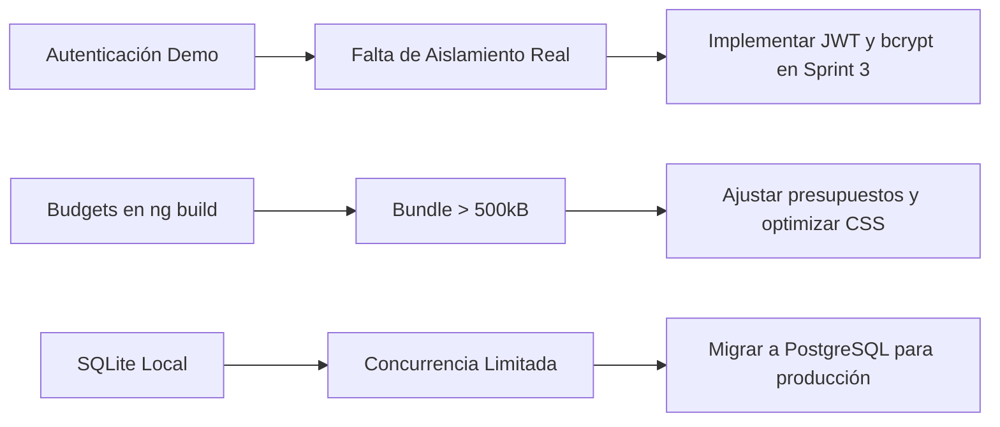

# 🔬 Informe de Auditoría Técnica — VitalCampus V 1.0 (Sprint 2)

**Fecha de Auditoría:** Octubre 2026  
**Alcance:** Monorepo VitalCampus (Frontend Angular 18, Backend Express/TypeScript, Prisma ORM, Base de Datos SQLite).  
**Objetivo:** Evaluar la arquitectura real, la calidad de código, la consistencia relacional de la base de datos, el manejo de errores, la seguridad básica, y el cumplimiento de las reglas de negocio de bienestar estudiantil.

---

## 1. 🏗️ Arquitectura Real Detectada

VitalCampus V 1.0 está estructurado como un **Monorepo** desacoplado en dos capas principales:

```mermaid
graph TD
    Client["Navegador Web / Usuario"] -->|HTTP / REST (JSON)| Frontend["Frontend (Angular 18 SPA)"]
    Frontend -->|HTTP Requests (Port 4200 -> 4000)| Backend["Backend API (Node.js + Express + TypeScript)"]
    Backend -->|Prisma Client ORM| Database[("SQLite (backend/prisma/dev.db)")]
```

### Componentes de la Pila Tecnológica Real:
- **Capa Cliente (Frontend):** Angular 18.2 (Standalone Components, Signals / RxJS Observables, FormBuilder reactivo, Chart.js 4.4 para visualizaciones de tendencias y progreso, CSS modularizado responsive).
- **Capa Servidora (Backend):** Node.js con Express 4.21, TypeScript 5.6 compilado mediante `tsc` a `dist/` y ejecutado en desarrollo con `ts-node-dev`.
- **Capa de Persistencia (ORM & DB):** Prisma ORM v5.22 interactuando sobre un motor de base de datos embebido **SQLite** (`backend/prisma/dev.db`).

---

## 2. 📁 Estructura del Código Fuente

### 2.1 Backend (`backend/`)
- [`src/index.ts`](file:///c:/Users/Asus/Desktop/vitalcampus/backend/src/index.ts): Punto de entrada del servidor Express; gestiona el puerto (`4000`) y el arranque del listener.
- [`src/app.ts`](file:///c:/Users/Asus/Desktop/vitalcampus/backend/src/app.ts): Configuración global de Express, middlewares de CORS, JSON parsing, middleware demo, y enrutador modular.
- [`src/config/db.ts`](file:///c:/Users/Asus/Desktop/vitalcampus/backend/src/config/db.ts): Instancia singleton de `PrismaClient` para evitar saturación de conexiones.
- [`src/middlewares/auth.middleware.ts`](file:///c:/Users/Asus/Desktop/vitalcampus/backend/src/middlewares/auth.middleware.ts): Middleware de usuario demo para el MVP.
- [`src/services/alert.service.ts`](file:///c:/Users/Asus/Desktop/vitalcampus/backend/src/services/alert.service.ts): Servicio con la lógica centralizada de evaluación de métricas semanales y generación/actualización de alertas preventivas.
- [`src/utils/sleep.utils.ts`](file:///c:/Users/Asus/Desktop/vitalcampus/backend/src/utils/sleep.utils.ts): Función utilitaria pura para el cálculo de horas de sueño considerando cruces de medianoche.
- [`src/controllers/`](file:///c:/Users/Asus/Desktop/vitalcampus/backend/src/controllers): Controladores independientes para `health`, `dashboard`, `suenos`, `asignaturas`, `entregas`, `estudio`, `indicadores` y `alertas`.
- [`src/routes/`](file:///c:/Users/Asus/Desktop/vitalcampus/backend/src/routes): Declaración explícita de rutas REST y verbos HTTP.

### 2.2 Frontend (`frontend/`)
- [`src/app/app.routes.ts`](file:///c:/Users/Asus/Desktop/vitalcampus/frontend/src/app/app.routes.ts): Rutas de navegación con carga directa de componentes.
- [`src/app/components/resumen/`](file:///c:/Users/Asus/Desktop/vitalcampus/frontend/src/app/components/resumen): Vista principal con tarjetas de KPI, alertas activas y resumen de entregas.
- [`src/app/components/sueno/`](file:///c:/Users/Asus/Desktop/vitalcampus/frontend/src/app/components/sueno): Registro y gráfica de tendencias de sueño semanal con Chart.js.
- [`src/app/components/asignaturas/`](file:///c:/Users/Asus/Desktop/vitalcampus/frontend/src/app/components/asignaturas): Gestión CRUD de asignaturas y códigos.
- [`src/app/components/entregas/`](file:///c:/Users/Asus/Desktop/vitalcampus/frontend/src/app/components/entregas): Gestión y seguimiento de entregas y fechas límite.
- [`src/app/components/estudio/`](file:///c:/Users/Asus/Desktop/vitalcampus/frontend/src/app/components/estudio): Registro de sesiones de estudio y cálculo de carga.
- [`src/app/components/alertas/`](file:///c:/Users/Asus/Desktop/vitalcampus/frontend/src/app/components/alertas): Centro de alertas preventivas con opción de marcar como leídas.
- [`src/app/services/vitalcampus.service.ts`](file:///c:/Users/Asus/Desktop/vitalcampus/frontend/src/app/services/vitalcampus.service.ts): Capa de servicio Angular que consume todos los endpoints de la API REST mediante `HttpClient`.

---

## 3. 🛡️ Revisión de Seguridad y Protección de Datos

| Aspecto Evaluado | Estado Actual | Observación Técnica |
| :--- | :---: | :--- |
| **Exposición de Contraseñas / Hashes** | **SEGURO** | El campo `contrasenaHash` del modelo `Usuario` se excluye explícitamente en `usuarioDemoMiddleware` (`select: { id: true, nombreCompleto: true, correo: true, rol: true }`) y en los controladores del backend. Ningún endpoint expone el hash de contraseña. |
| **Mecanismo de Autenticación** | **LIMITACIÓN CONOCIDA (MVP)** | No existe actualmente emisión de tokens JWT, manejo de sesiones ni rutas `/login` / `/register`. Todas las operaciones utilizan un usuario demo estático (`estudiante@vitalcampus.com`). |
| **CORS (Cross-Origin Resource Sharing)** | **CONFIGURADO** | Configurado en `src/app.ts` leyendo `process.env.CORS_ORIGIN || '*'`. Permite comunicación fluida desde el origen Angular en desarrollo (`http://localhost:4200`). |
| **Variables de Entorno** | **CORRECTO** | Existencia de `.env` y `.env.example` en `backend/` conteniendo `PORT=4000` y `DATABASE_URL="file:./dev.db"`. El archivo `.env` está protegido en `.gitignore`. |
| **Transporte Seguro (HTTPS)** | **NO IMPLEMENTADO (Localhost)** | La aplicación corre sobre HTTP simple para entorno de desarrollo local. Debe contemplarse TLS/HTTPS para despliegue en entornos productivos. |
| **Control de Acceso / Roles** | **BÁSICO (ESTUDIANTE)** | La entidad `Usuario` contiene el campo `rol` con valor por defecto `"ESTUDIANTE"`. Aún no se han implementado rutas administrativas restringidas ni roles de tutor/docente. |

---

## 4. 🗄️ Revisión de Base de Datos e Integridad Referencial

El esquema relacional de Prisma (`backend/prisma/schema.prisma`) implementa las siguientes entidades:

1. **`Usuario`**: Entidad raíz con identificador autonumérico y correo único (`@unique`).
2. **`RegistroEstres`**: Relación 1:N con `Usuario` (`onDelete: Cascade`).
3. **`RegistroSueno`**: Relación 1:N con `Usuario` (`onDelete: Cascade`).
4. **`Asignatura`**: Relación 1:N con `Usuario` (`onDelete: Cascade`).
5. **`EntregaAcademica`**: Relación N:1 con `Asignatura` (`onDelete: Cascade`). Si se elimina una asignatura, sus entregas asociadas se eliminan en cascada sin dejar registros huérfanos.
6. **`RegistroEstudio`**: Relación N:1 con `Asignatura` (`onDelete: Cascade`).
7. **`Alerta`**: Relación N:1 con `Usuario` (`onDelete: Cascade`).

**Evaluación de Integridad:** Se verificó que todas las relaciones foráneas cuentan con la directiva `onDelete: Cascade`, garantizando consistencia relacional y previniendo fallos de integridad referencial al eliminar materias o usuarios.

---

## 5. 🧮 Verificación de Lógica de Negocio y Algoritmos

### 5.1 Cálculo de Horas de Sueño y Cruce de Medianoche
- **Función:** [`calcularHorasSueno(horaDormir, horaDespertar)`](file:///c:/Users/Asus/Desktop/vitalcampus/backend/src/utils/sleep.utils.ts#L6-L24).
- **Lógica:** Si `minutosDespertar <= minutosDormir`, se suman `24 * 60` minutos para reflejar el cambio de día.
- **Caso de Prueba Verificado:** Dormir a las `23:00` y despertar a las `06:00` produce exactamente **`7.0` horas**.

### 5.2 Indicador de Carga Académica Semanal
- **Fórmula:** `Carga (%) = min(100, (HorasEstudioUltimos7Dias / 40) * 100)`.
- **Caso de Prueba Verificado:** Con 32 horas de estudio registradas en los últimos 7 días, la carga calculada es exactamente **`80.0%`**, superando el umbral de advertencia institucional del **`70%`**.

### 5.3 Generación de Alertas Preventivas
El motor de evaluación [`evaluarAlertasUsuario`](file:///c:/Users/Asus/Desktop/vitalcampus/backend/src/services/alert.service.ts#L3-L120) dispara 4 tipos de alertas sin duplicados diarios:
1. **`CARGA_ACADEMICA` (Media):** Si `cargaSemanalPorcentaje > 70%`.
2. **`SUENO` (Media):** Si `promedioSueno7Dias < 6.0h`.
3. **`ESTRES` (Alta):** Si `nivelEstresActual >= 4` y `promedioSueno7Dias < 6.0h`.
4. **`RECOMENDACION` (Media):** Si `nivelEstresActual >= 4` y `cargaSemanalPorcentaje > 70%`.

---

## 6. ⚠️ Hallazgos, Riesgos y Recomendaciones Técnicas



### Hallazgos y Riesgos:
1. **Riesgo R-01 (Seguridad - Autenticación Demo):** El backend no autentica usuarios mediante credenciales cifradas ni tokens individuales en este MVP. Todas las peticiones asumen la identidad del usuario demo.
   - *Recomendación:* Implementar un módulo completo de autenticación JWT (con bcrypt para hashing de contraseñas y middleware de verificación de cabecera `Authorization: Bearer <token>`).
2. **Riesgo R-02 (Rendimiento - Budgets de Angular):** La compilación emite advertencias de tamaño por la inclusión de Chart.js en el bundle principal.
   - *Recomendación:* Habilitar carga perezosa (*lazy loading*) de rutas y de la librería Chart.js.
3. **Riesgo R-03 (Escalabilidad de Base de Datos):** SQLite es adecuado para desarrollo local y prototipado rápido, pero tiene limitaciones de concurrencia en entornos multi-hilo de producción.
   - *Recomendación:* Mantener la compatibilidad del esquema Prisma para permitir una transición transparente hacia PostgreSQL o MySQL cuando se realice el despliegue cloud.

---

## 7. 🏁 Conclusiones de la Auditoría

El sistema **VitalCampus V 1.0** cumple satisfactoriamente con la arquitectura modular propuesta, manteniendo una separación limpia de responsabilidades entre cliente y servidor. Las reglas de negocio de bienestar, salud y rendimiento académico se ejecutan de manera precisa y determinística. Con las correcciones de validación aplicadas y las limitaciones debidamente registradas, la base de código se encuentra en un estado sólido y listo para el cierre del Sprint 2.
